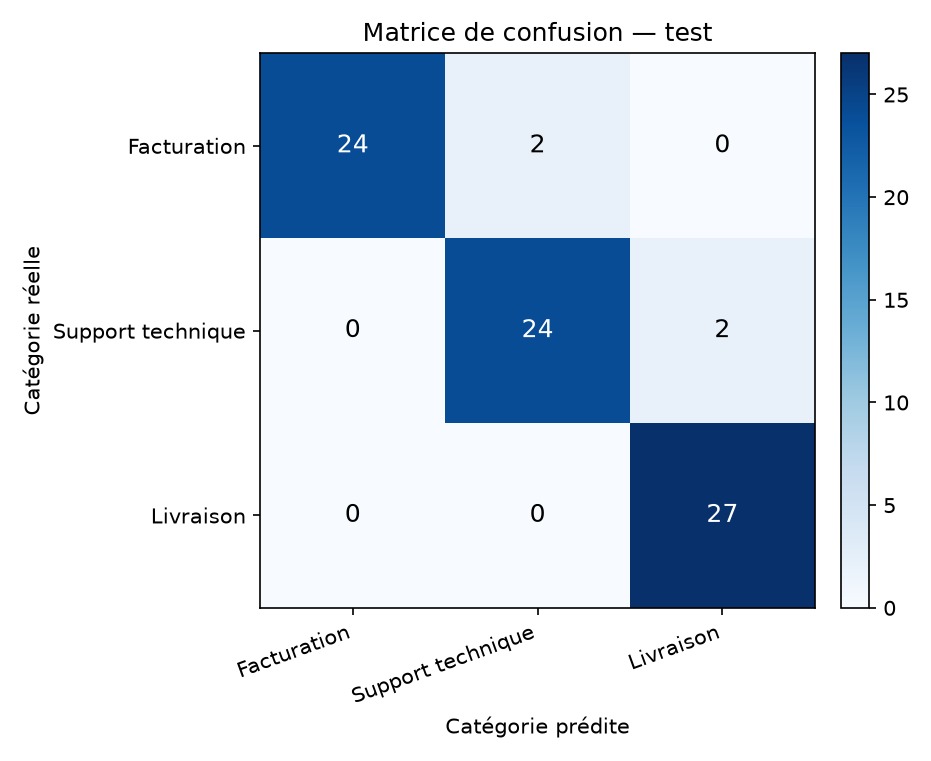
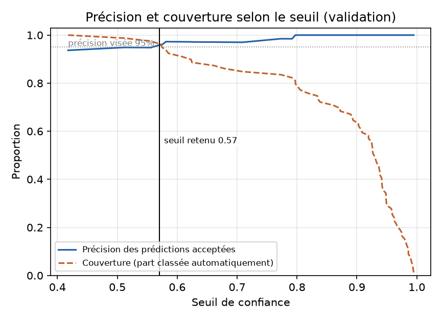

# Évaluation du modèle de classification des réclamations

_Rapport généré automatiquement par `python -m classifier.evaluate` le 15/11/2026 à 22:30 — modèle v1.0.0 entraîné le 2026-11-15T22:29:38+00:00._

## 1. Synthèse

- Modèle retenu : **TF-IDF mots + caractères, SVM linéaire (LinearSVC)**, probabilités calibrées.
- Jeu de test (utilisé une seule fois, 79 réclamations) : **accuracy 94.9 %**, **F1 macro 94.9 %** (base naïve : accuracy 32.9 %, F1 macro 16.5 %).
- Objectif du cahier des charges (≥ 85 % d'accuracy et de F1 macro sur le test) : **atteint** — sur un jeu rédigé, voir les limites (§8).
- Seuil de confiance retenu : **0.57**. Sur le test : 94.9 % des réclamations classées automatiquement avec une précision de 97.3 % ; 4 réclamation(s) envoyée(s) en classement manuel.
- Temps d'inférence moyen : **25.9 ms** par réclamation (p95 39.9 ms), très en dessous de l'exigence de 2 s.

## 2. Jeu de données

- 525 réclamations en français rédigées pour le projet (`data/claims.csv`), 175 « Facturation », 175 « Support technique », 175 « Livraison ».
- 48 cas difficiles ou ambigus (9.1 %), à cheval entre deux catégories ; l'étiquette suit la règle « le service qui doit agir sur la cause principale » et est justifiée dans la colonne `note`.
- Variété : registres formel, familier, SMS, sans accents, fautes de frappe, quelques phrases en darija et en anglais ; longueurs de 3 mots à plus de 100 mots ; titres parfois non informatifs (« URGENT », « Réclamation », « bonjour »).
- Dédoublonnage avant découpage : doublons exacts après normalisation, puis quasi-doublons (similarité cosinus des n-grammes de caractères ≥ 0.80). Lignes retirées : 0 ; similarité maximale restante entre deux textes : 0.62.
- Découpage stratifié, graine 42 : entraînement 367 (70 %), validation 79 (15 %), test 79 (15 %).

## 3. Méthode

- **Représentation** : TF-IDF sur mots (1-2 grammes) **et** sur n-grammes de caractères (2-5),
  après normalisation (minuscules, accents retirés, chiffres ramenés à 0, ponctuation retirée).
  Les n-grammes de caractères rendent le modèle tolérant aux fautes de frappe, au style SMS
  (« jai », « recu », « svp ») et aux textes sans accents.
- **Modèles comparés** : régression logistique, SVM linéaire (LinearSVC) et Naive Bayes
  complémentaire, plus une base naïve (classe majoritaire). Hyperparamètres réglés par
  GridSearchCV (5 plis stratifiés, F1 macro) sur l'entraînement uniquement ; sélection sur la
  validation (F1 macro, puis accuracy, puis score de validation croisée en cas d'égalité).
- **Modèle d'embeddings préentraîné non retenu** : un encodeur multilingue (type
  sentence-transformers) impose PyTorch et le téléchargement du modèle (environ 1 Go au total),
  pour un gain incertain sur 525 textes, avec un temps d'inférence plus élevé sur CPU. Le cahier
  des charges (§9) le cite comme une possibilité, pas comme une obligation ; il pourra être
  testé plus tard sur des données réelles.
- **Confiance** : probabilité calibrée (CalibratedClassifierCV, sigmoïde, 5 plis sur
  l'entraînement) de la catégorie prédite. Un LinearSVC ne fournit pas de probabilités ; la
  calibration les rend comparables à un seuil.
- **Texte vide ou trop court** (moins de 3 caractères alphanumériques) : pas de
  prédiction, classement manuel.
- **Le service se déduit de la catégorie** (correspondance 1-1 du claim-service : Facturation,
  Support technique, Livraison).

## 4. Comparaison des modèles (validation)

| Modèle | CV F1 macro (entraînement) | Accuracy validation | F1 macro validation |
|---|---:|---:|---:|
| Base naïve : classe majoritaire de l'entraînement | — | 32.9 % | 16.5 % |
| TF-IDF mots + caractères, régression logistique | 96.2 % ± 2.2 % | 94.9 % | 94.9 % |
| TF-IDF mots + caractères, SVM linéaire (LinearSVC) **(retenu)** | 96.4 % ± 1.9 % | 94.9 % | 94.9 % |
| TF-IDF mots + caractères, Naive Bayes complémentaire | 95.6 % ± 2.8 % | 93.7 % | 93.7 % |

Base naïve (classe majoritaire) sur la validation : accuracy 32.9 %, F1 macro 16.5 %.

Hyperparamètres retenus : `C` = 3.0, `features__chars__ngram_range` = [2, 5], `features__words__ngram_range` = [1, 2]. Après calibration, le modèle obtient sur la validation une accuracy de 93.7 % et un F1 macro de 93.6 %.

Les trois approches sont très proches (écarts inférieurs à une ou deux réclamations sur 79) : sur ce jeu, le choix du classifieur compte moins que la représentation TF-IDF mots + caractères.

## 5. Résultats sur le jeu de test (évaluation finale, une seule fois)

### Modèle retenu

| Classe | Précision | Rappel | F1-score | Support |
|---|---:|---:|---:|---:|
| Facturation | 100.0 % | 92.3 % | 96.0 % | 26 |
| Support technique | 92.3 % | 92.3 % | 92.3 % | 26 |
| Livraison | 93.1 % | 100.0 % | 96.4 % | 27 |
| **Macro** | **95.1 %** | **94.9 %** | **94.9 %** | 79 |
| **Accuracy** | | | **94.9 %** | 79 |

### Base de référence naïve (classe majoritaire)

| Classe | Précision | Rappel | F1-score | Support |
|---|---:|---:|---:|---:|
| Facturation | 32.9 % | 100.0 % | 49.5 % | 26 |
| Support technique | 0.0 % | 0.0 % | 0.0 % | 26 |
| Livraison | 0.0 % | 0.0 % | 0.0 % | 27 |
| **Macro** | **11.0 %** | **33.3 %** | **16.5 %** | 79 |
| **Accuracy** | | | **32.9 %** | 79 |

### Matrice de confusion (test)

| Réel \ Prédit | Facturation | Support technique | Livraison |
|---|---:|---:|---:|
| Facturation | 24 | 2 | 0 |
| Support technique | 0 | 24 | 2 |
| Livraison | 0 | 0 | 27 |

### Temps d'inférence

| Mesure | Valeur |
|---|---:|
| Moyenne par réclamation (appel unitaire) | 25.86 ms |
| Médiane | 24.63 ms |
| 95e centile | 39.89 ms |
| Maximum | 67.83 ms |
| Par réclamation, traitement par lot | 2.18 ms |
| Chargement du modèle (une fois au démarrage) | 236 ms |

Mesuré sur 237 appels (3 passages sur le test), CPU, Python 3.12.10, scikit-learn 1.9.1.

## 6. Score de confiance et seuil de repli (BF18, BF19)

Règle : plus petit seuil (couverture maximale) tel que la précision des prédictions acceptées sur la validation soit ≥ 95% (au moins 20 acceptées). Le seuil est calculé sur la validation, puis vérifié sur le test.

| Ensemble | Seuil | Couverture (automatique) | Précision des acceptées | Envoyées en manuel | Erreurs acceptées | Erreurs interceptées |
|---|---:|---:|---:|---:|---:|---:|
| Validation | 0.57 | 96.2 % | 96.1 % | 3 | 3 | 2 |
| Test | 0.57 | 94.9 % | 97.3 % | 4 | 2 | 2 |

Confiance moyenne sur le test : 88.1 % pour les bonnes prédictions, 64.5 % pour les erreurs.

Interprétation : en dessous du seuil, la réclamation est enregistrée sans catégorie et passe en classement manuel par l'administrateur (statut NEW). Au-dessus, la catégorie et le service proposés restent modifiables par l'agent (BF14), ce qui rattrape les erreurs acceptées. Relever le seuil intercepte plus d'erreurs mais envoie plus de réclamations correctes en manuel ; la courbe montre ce compromis. Le seuil devra être recalculé sur des réclamations réelles.

## 7. Analyse des erreurs

Sur l'ensemble validation + test : 9 erreur(s), dont 5 sur des cas annotés comme ambigus (ceux-ci ne représentent que 9.1 % des données).

### Erreurs sur le test

| # | Réclamation (titre — description) | Réelle | Prédite | Confiance | Seuil atteint | Indices |
|---|---|---|---|---:|---|---|
| 156 | **Remise collaborateur** — Je suis salarié d'une entreprise partenaire, la remise de 12 % ne s'applique plus depuis le changement de site. | Facturation | Support technique | 53.5 % | non (manuel) | termes tirant vers « Support technique » : plus, changement, «pli», «ppli», «appli», «appl» |
| 160 | **Réclamation sur un avoir partiel** — L'avoir émis ne couvre pas l'accessoire retourné en même temps que l'appareil. | Facturation | Support technique | 86.6 % | oui | termes tirant vers « Support technique » : reclamation, meme, appareil, pas, en meme, meme temps |
| 356 | **Produit retourné, réparation non faite** — J'ai envoyé mon téléphone en réparation il y a 3 semaines, le transporteur l'a bien livré au centre, mais je n'ai aucune nouvelle de la réparation. | Support technique | Livraison | 61.2 % | oui | cas ambigu annoté — Livraison/Support : le transport a eu lieu, le retard porte sur la réparation sous garantie.; termes tirant vers « Livraison » : transporteur, le transporteur, livre, envoye, semaines, de la |
| 363 | **Annulation impossible avant expédition** — Je veux annuler ma commande avant l'expédition, mais le bouton Annuler donne une erreur. | Support technique | Livraison | 56.7 % | non (manuel) | cas ambigu annoté — Livraison/Facturation/Support : il faut annuler, mais la demande porte sur le bouton en erreur.; termes tirant vers « Livraison » : expedition, avant, commande, «expe», «exped», «ped» |

### Erreurs sur la validation

| # | Réclamation (titre — description) | Réelle | Prédite | Confiance | Seuil atteint | Indices |
|---|---|---|---|---:|---|---|
| 8 | **Commande bloquée après paiement** — Ma commande est payée mais bloquée au statut Paiement en vérification depuis 5 jours, rien n'est expédié. | Facturation | Livraison | 79.2 % | oui | cas ambigu annoté — Livraison/Facturation : l'expédition attend la validation du paiement, à débloquer par la Facturation.; termes tirant vers « Livraison » : commande, est, payee, jours, ma commande, commande est |
| 14 | **Carte cadeau inutilisable** — Ma carte cadeau est refusée : le site dit Code invalide alors qu'elle a été achetée chez vous hier. | Facturation | Support technique | 70.9 % | oui | cas ambigu annoté — Facturation/Support : il faut vérifier le solde et l'activation de la carte cadeau, qui est un moyen de paiement.; termes tirant vers « Support technique » : code, chez vous, achetee, hier, invalide alors, inutilisable |
| 60 | **Points fidélité disparus** — J'avais 2 300 points sur mon compte fidélité, aujourd'hui il m'en reste 300 sans que je les aie utilisés. Où sont passés les 2 000 points ? | Facturation | Livraison | 41.8 % | non (manuel) | termes tirant vers « Livraison » : sont, sans, que je, sans que, «lis», hui |
| 92 | **Tarif différent entre application et site** — Le même casque est à 590 DH sur l'application et 650 DH sur le site. J'ai commandé sur le site sans faire attention, j'aimerais qu'on m'applique le prix de l'a… | Facturation | Support technique | 57.5 % | oui | termes tirant vers « Support technique » : application, qu on, de application, «catio», casque, «licat» |
| 355 | **Suivi de colis inaccessible** — La page de suivi de colis affiche une erreur 404 pour toutes mes commandes. | Support technique | Livraison | 55.6 % | non (manuel) | cas ambigu annoté — Livraison/Support : les colis ne sont pas forcément en retard, c'est la page de suivi du site qui est cassée.; termes tirant vers « Livraison » : colis, suivi, «oli», «coli», «olis», «lis» |

Les « indices » sont calculés automatiquement : note d'ambiguïté, longueur du texte et termes (mots ou «n-grammes» de caractères) dont le poids pousse le plus vers la catégorie prédite, lus sur une copie non calibrée du modèle entraînée sur le même jeu d'entraînement.

Hypothèses :

- **Cas à cheval entre deux services** (5/9 erreurs) : ces réclamations citent le vocabulaire de deux catégories (un suivi de colis cassé sur le site, une commande bloquée par un paiement en vérification). Le modèle s'appuie sur les mots, pas sur la règle « qui doit agir » ; ces cas relèvent de la validation humaine.
- **Confusion la plus fréquente** : « Facturation » prédite « Support technique » (4/9 erreurs).
- **Mots-clés trompeurs, sujet peu représenté** (4/9 erreurs, non annotées ambiguës : « Points fidélité disparus », « Tarif différent entre application et site », « Remise collaborateur », « Réclamation sur un avoir partiel ») : le sujet réel s'exprime avec un vocabulaire rare dans l'entraînement, et des mots ou fragments associés à une autre catégorie l'emportent (voir la colonne Indices).
- **Textes très courts** : 0/9 erreur(s). Les textes courts du jeu contiennent en général un mot-clé décisif (« colis », « facture », « bug ») ; sur des données réelles, des messages vides de sens comme « problème » seraient plus fréquents.
- **Rôle du seuil** : 4/9 erreur(s) passent sous le seuil et partent en classement manuel ; les 5 autres seraient proposées à tort, puis corrigées par l'agent (BF14).
- **Pistes** : plus de données réelles (corrections des agents, BF20), exemples ciblés sur les couples de catégories confondus, et éventuellement un encodeur préentraîné si les données réelles montrent des formulations que TF-IDF ne capte pas.

## 8. Limites

1. **Jeu de données entièrement rédigé par un modèle de langage** (à la demande de l'équipe ;
   le cahier des charges §10 prévoyait un jeu public adapté complété par des exemples rédigés).
   Aucune réclamation réelle n'a été utilisée.
2. **Distribution plus « propre » que le monde réel** : chaque texte a été écrit pour illustrer
   une catégorie, avec un vocabulaire souvent caractéristique (colis, livreur, facture,
   remboursement, application…). Les vraies réclamations mélangent plusieurs sujets, contiennent
   des informations inutiles, des messages copiés-collés, des pièces jointes sans texte, etc.
3. **Scores probablement optimistes** : les mêmes « habitudes d'écriture » du rédacteur se
   retrouvent dans l'entraînement et dans le test (même auteur, mêmes tournures). Le modèle peut
   apprendre ce style autant que le sujet. Les métriques obtenues ici sont un **plafond
   indicatif**, pas une estimation des performances en production ; il faudra les mesurer à
   nouveau sur des réclamations réelles (corrections des agents, BF20).
4. **Classes parfaitement équilibrées (175 par catégorie)** : en production, une catégorie sera
   plus fréquente que les autres ; la précision par classe changera.
5. **Variété limitée** : 525 textes, 3 catégories, un contexte fictif (commerce en ligne
   marocain). Les registres familiers, SMS, sans accents et les quelques phrases en darija ou en
   anglais sont présents mais peu nombreux ; ils restent sous-représentés par rapport à la
   réalité.
6. **Ambiguïté tranchée par une règle unique** (« le service qui doit agir sur la cause
   principale »), choisie par le rédacteur : un autre annotateur aurait pu étiqueter autrement
   certains cas. Aucun accord inter-annotateurs n'a été mesuré.
7. **Petits ensembles de validation et de test (79 réclamations chacun)** : une erreur de plus
   ou de moins fait varier l'accuracy d'environ 1,3 point ; l'intervalle de confiance à 95 %
   autour des scores est de l'ordre de ±4 à ±5 points. Le seuil de confiance, choisi sur 79
   exemples, est lui aussi approximatif et devra être réajusté sur données réelles.
8. **Dédoublonnage par similarité de surface** (n-grammes de caractères) : il élimine les
   copies et reformulations proches, pas deux textes différents décrivant la même situation —
   ce qui est voulu, car c'est aussi le cas des vraies réclamations.

## 9. Reproductibilité

| Élément | Valeur |
|---|---|
| Version du modèle | 1.0.0 |
| Graine | 42 |
| Empreinte SHA-256 de `data/claims.csv` | `c062818a16a6d690…` |
| python | 3.12.10 |
| scikit-learn | 1.9.1 |
| numpy | 2.5.5 |
| scipy | 1.18.1 |
| pandas | 3.1.1 |
| joblib | 1.6.0 |
| matplotlib | 3.11.2 |

Commandes (depuis `ai-classifier-service/`) : `python -m classifier.dataset`, `python -m classifier.train`, `python -m classifier.evaluate`.
